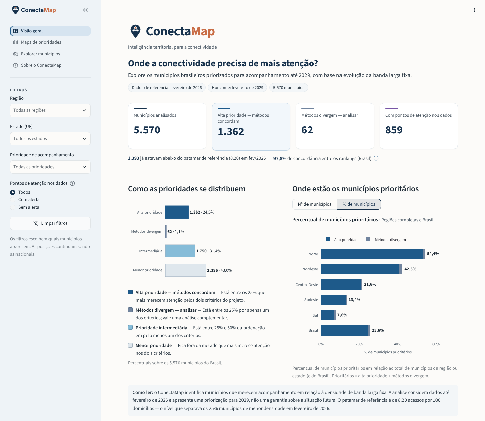
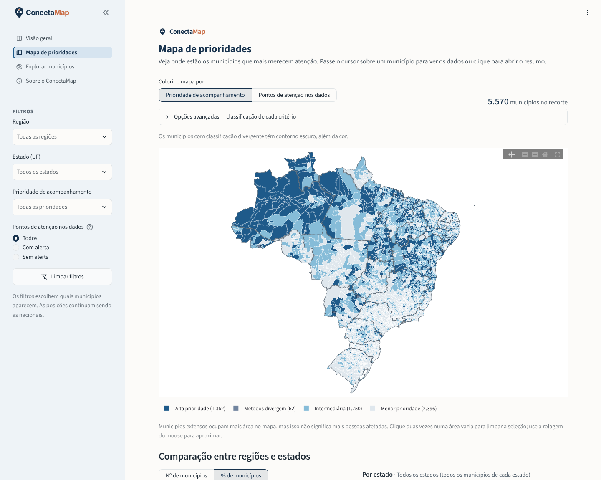
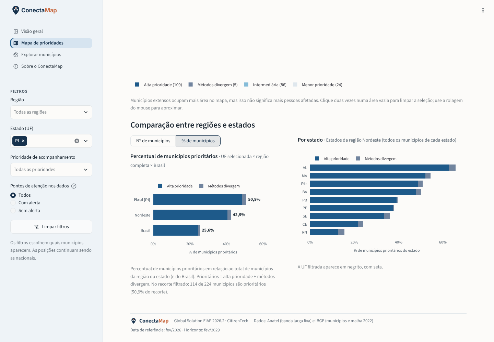

# ConectaMap — Inteligência Territorial para Conectividade
Global Solution FIAP 2026.2 · CitizenTech

O acesso à banda larga fixa é muito desigual entre os municípios brasileiros. Em fevereiro de 2026, um quarto deles tinha menos de **8,20 acessos por 100 domicílios**, enquanto a mediana nacional era de 17,1.

O ConectaMap usa a série histórica da Anatel para **priorizar os municípios com maior risco relativo de continuar com baixa densidade de banda larga fixa em fevereiro de 2029**, 36 meses após os dados mais recentes. O resultado é publicado em um dashboard interativo.



## Objetivo
Ajudar o planejamento de políticas de conectividade a identificar **onde a atenção é mais necessária**:
- quais municípios merecem acompanhamento prioritário;
- como eles se distribuem por região e estado;
- em quais casos os critérios de priorização concordam;
- onde os dados pedem conferência antes de qualquer decisão.

O resultado é uma **priorização relativa**, não uma garantia sobre a situação futura.

## Funcionalidades do dashboard
- **Mapa municipal interativo** dos 5.570 municípios, colorido por prioridade de acompanhamento ou por pontos de atenção nos dados. Ao clicar num município, abre-se o resumo dele.
- **Filtros** por região, estado, categoria de prioridade e pontos de atenção, válidos em todas as páginas.
- **Categorias de prioridade:** alta prioridade (os dois critérios concordam), classificação divergente, intermediária e menor prioridade.
- **Busca e ranking de municípios**, com exportação em CSV.
- **Comparação entre critérios:** a ordenação do modelo preditivo ao lado da ordenação pela densidade atual.
- **Indicadores de qualidade dos dados**, mantidos separados da prioridade.
- **Comparação territorial:** cada estado, sua região e o Brasil, sempre com o total de municípios de cada território como base.



## Metodologia resumida
1. **Dados históricos da Anatel:** densidade de banda larga fixa por município, de 2007 a fevereiro de 2026.
2. **Tratamento:**
   - padronização dos códigos IBGE;
   - organização temporal;
   - identificação de meses ausentes, que não são preenchidos;
   - sinalização estatística de observações atípicas, sem alterar os valores publicados.
3. **Modelo Random Forest:** treinado com origens de fevereiro de 2014 a 2023 e 30 variáveis calculadas só com dados até a origem.
4. **Comparação com a densidade atual:** o modelo é comparado com baselines, principalmente a ordenação pela densidade atual (B2), com validação temporal de 2019 a 2022 e um teste reservado de 2023.
5. **Horizonte de 36 meses:** o alvo é ficar abaixo do P25 nacional da origem 36 meses depois. Para 2029, o limiar é o P25 de fevereiro de 2026 (8,20), congelado.
6. **Priorização relativa:** em fevereiro de 2029, os municípios são classificados pela concordância entre o ranking do modelo e o da densidade atual.

**Fontes das variáveis do modelo**
- **Anatel:** o modelo principal usa **somente variáveis temporais da série da Anatel**.
- **IBGE:** fornece a identificação dos municípios e a malha geográfica. Os dados do Censo 2022 foram tratados no pré-processamento, mas **não entraram no treinamento principal**.

Detalhes em [`docs/metodologia_resumida.md`](docs/metodologia_resumida.md).

## Resultados
| Indicador | Municípios |
|---|---|
| Municípios analisados | **5.570** |
| Alta prioridade (consenso entre os dois critérios) | **1.362** |
| Classificação divergente (em só um dos critérios) | **62** |
| Prioridade intermediária | **1.750** |
| Menor prioridade | **2.396** |
| Com pontos de atenção nos dados (dimensão separada) | 859 |



**Como ler esses números**
- **Concordância:** os dois critérios selecionam 97,8% dos mesmos municípios entre os 25% primeiros. Esse valor mede a concordância das listas, não a precisão da previsão.
- **Random Forest × densidade atual:** o Random Forest **não demonstrou vantagem robusta** sobre a ordenação pela densidade atual. No teste reservado de 2023, a PR-AUC foi de 0,521 contra 0,516.
- **Escore do modelo:** os escores **não são probabilidades calibradas**. Servem só para ordenar.
- **2029:** nenhuma densidade de 2029 é estimada.

## Tecnologias
- **Linguagem:** Python 3.13.
- **Dados e modelagem:** pandas, NumPy, scikit-learn e Matplotlib.
- **Notebooks:** Jupyter.
- **Dashboard:** Streamlit e Plotly, com mapa MapLibre sem servidor externo de blocos.
- **Testes:** pytest.
- **Preparação das geometrias** (script executado uma única vez): shapely.

## Como executar o dashboard
Na raiz do repositório:

```bash
pip install -r requirements.txt
streamlit run dashboard/app.py
```

- **Endereço:** o app abre em `http://localhost:8501`.
- **Dados necessários:** usa só os arquivos já incluídos no repositório (a previsão aprovada e a malha municipal). Não treina modelos, não baixa dados e não exige credenciais.
- **Testes do dashboard:** rode `pip install pytest` e depois `python -m pytest -q dashboard/tests`.

## Como executar os notebooks
| Notebook | Conteúdo |
|---|---|
| `ConectaMap_Pre_Processamento.ipynb` | Etapa 1: dos arquivos brutos da Anatel e do IBGE às bases tratadas |
| `ConectaMap_Etapa2_Painel.ipynb` | Etapa 2: painel temporal, modelos, validação, calibração e priorização de 2029 |

Os notebooks ficam na raiz porque leem os arquivos a partir dela. Abra-os com a **raiz do repositório como pasta de trabalho** e instale as dependências:

```bash
pip install -r requirements-notebooks.txt
```

> **Bases históricas fora deste repositório.** Os notebooks podem ser lidos aqui com todas as saídas já executadas, mas **não podem ser reexecutados só com o conteúdo do GitHub**. As bases históricas passam dos limites de um repositório (a base tratada da Anatel tem 131 MB) e foram mantidas no pacote técnico completo do projeto:
>
> | Pasta | Tamanho | Necessária para |
> |---|---|---|
> | `dados_brutos/` | 39 MB | Notebook 1 (entrada) |
> | `auditoria_tecnica/` | 40 MB | Notebook 1 (conferência final com a Etapa 1.5) |
> | `dados_tratados/` | 193 MB | Notebook 2 e parte dos testes de `tests/` (é gerada pelo Notebook 1) |
>
> **Disponibilidade do pacote técnico:** _a definir_.

**Para reproduzir**
1. Copie essas pastas para a raiz do repositório. O `.gitignore` já impede que sejam versionadas.
2. Execute o Notebook 1 (cerca de 2 minutos) e depois o Notebook 2 (cerca de 2,5 minutos).

O Notebook 2 reconstrói o painel e a previsão e os **confere byte a byte** com os arquivos aprovados de `etapa2/saidas/`, sem regravá-los.

**Testes da Etapa 2**
- **Comando:** `python -m pytest -q tests`.
- **Sem as bases históricas:** os testes que dependem delas são pulados automaticamente.

## Fontes dos dados
| Fonte | Finalidade |
|---|---|
| **Anatel** — densidade de banda larga fixa por município (obtida pela Base dos Dados, tabela `br_anatel_banda_larga_fixa.densidade_municipio`) | Série histórica usada nas variáveis do modelo, no alvo e na priorização |
| **IBGE — Censo Demográfico 2022** (SIDRA, tabelas 9923, 9515, 6805, 10295 e 10125) | Características municipais tratadas no pré-processamento; não usadas no modelo principal |
| **IBGE — Malha Municipal 2022** (versão simplificada redistribuída pelo pacote geobr, IPEA) | Geometrias do mapa; origem e preparo em `dashboard/assets/geometrias_metadados.json` |

## Estrutura do repositório
```
├── ConectaMap_Pre_Processamento.ipynb   Notebook 1 — pré-processamento
├── ConectaMap_Etapa2_Painel.ipynb       Notebook 2 — modelagem e previsão para 2029
├── conectamap/                          módulos Python usados pelos notebooks
├── dashboard/                           aplicativo Streamlit (app, gráficos, dados, paleta, malha em assets/, testes)
├── etapa2/
│   ├── protocolo_treino_congelado.json  protocolo do modelo, congelado antes do teste
│   └── saidas/
│       ├── previsao2029/                base final de 2029 (5.570 municípios), dicionário e confiabilidade
│       ├── treino/                      métricas de seleção, validação e teste reservado
│       ├── figuras/                     gráficos do Notebook 2
│       └── painel_origens_fevereiro.csv.gz   painel temporal aprovado
├── tests/                               testes da Etapa 2 (executados pelo Notebook 2)
├── docs/                                metodologia resumida e imagens
├── .streamlit/config.toml               tema do dashboard
├── requirements.txt                     dependências do dashboard
└── requirements-notebooks.txt           dependências dos notebooks e testes
```

**Dados usados pelo dashboard**
- **Pasta:** o dashboard lê os resultados em `etapa2/saidas/`, os mesmos arquivos que o Notebook 2 confere. Assim, há uma única cópia dos dados aprovados.
- **Base principal:** `previsoes_2029_municipios.csv`.
- **Leitura de `id_municipio`:** como texto.
- **Mais detalhes:** veja [`dashboard/README.md`](dashboard/README.md).

## Autores
| Nome | RM | Turma |
|---|---|---|
| _a preencher_ | _a preencher_ | _a preencher_ |

## Links
- **Dashboard (Streamlit Community Cloud):** _a preencher_
- **Repositório GitHub:** _a preencher_
- **Vídeo pitch:** _a preencher_
